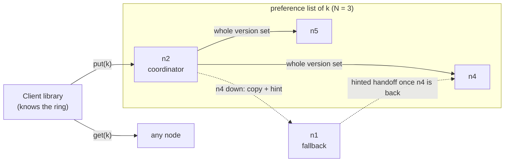
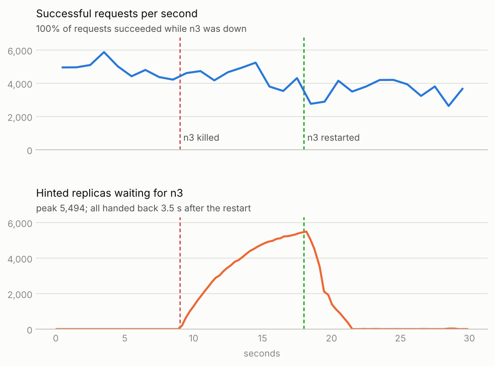

# dynamo-kv-store

[](https://github.com/puneethakshay00-cpu/dynamo-kv-store/actions/workflows/ci.yml)

A distributed key-value store in Python, built from Amazon's
[Dynamo paper](https://www.allthingsdistributed.com/files/amazon-dynamo-sosp2007.pdf):
consistent hashing, sloppy quorums, hinted handoff, read repair, Merkle-tree
anti-entropy and gossip-based failure detection. It comes with a **deterministic
fault-injection simulator** that runs the real node code through crashes, network
partitions and lossy networks, and checks after every run that no acknowledged write was
lost.

## Results

| Test | Result |
|---|---|
| 10,000 simulated scenarios with node crashes, network partitions, packet loss and duplication | **0** of 4,658,048 acknowledged writes lost; every replica converged |
| The same workload with the vector clocks the Dynamo paper describes | 25,800 acknowledged writes lost, in 1,000 of 1,000 runs *without any faults* |
| Strict quorum (R + W > N) under the same failures | **0** stale reads in 526,464 reads; 95.2% of requests served |
| Sloppy quorum with hinted handoff (the default) under the same failures | 96.9% of requests served; 4.5% of reads stale |
| Real TCP cluster: one node killed for 9 s under load | 100% of 40,008 requests during the outage succeeded; 5,494 hinted replicas handed back 3.5 s after the restart |
| Throughput: 5 node processes and the load generator sharing 2 vCPUs | 4,944 requests/s at N=3, R=2, W=2; median write latency 5 ms |

## How it works



* **Partitioning.** Keys hash onto a ring with 32 virtual nodes per server. Each key lives
  on the first N = 3 distinct servers clockwise from it.
* **Writes.** A replica of the key coordinates the write. It sends the key's whole version
  set to the other replicas and answers after W of them, itself included, have stored it.
  If a replica is down, the next healthy node keeps the copy as a *hint* and hands it
  back when the replica returns (sloppy quorum).
* **Reads.** Any node asks the first N healthy nodes and answers after R reply. It
  returns every concurrent value plus a *context*, then repairs replicas that answered
  with stale data (read repair).
* **Conflicts.** Concurrent writes are kept side by side as *siblings* until a client
  writes a merged value with the context it read. Causality is tracked with **dotted
  version vectors** rather than the paper's vector clocks; the next section explains why.
* **Background repair.** Gossip heartbeats detect failures. Merkle trees let replica
  pairs find and fix differences by exchanging a hash per tree level instead of their
  data.

| Dynamo technique | Paper | Code |
|---|---|---|
| Consistent hashing with virtual nodes | §4.2 | [`ring.py`](src/dynamokv/ring.py) |
| Versioned writes, siblings returned to the client | §4.4 | [`version.py`](src/dynamokv/version.py) |
| Quorum reads and writes, sloppy quorum | §4.5 | [`node.py`](src/dynamokv/node.py) |
| Hinted handoff | §4.6 | [`node.py`](src/dynamokv/node.py), [`storage.py`](src/dynamokv/storage.py) |
| Merkle-tree anti-entropy | §4.7 | [`merkle.py`](src/dynamokv/merkle.py) |
| Gossip-based failure detection | §4.8 | [`node.py`](src/dynamokv/node.py) |
| Read repair | §5 | [`node.py`](src/dynamokv/node.py) |
| Durable write-ahead log | | [`storage.py`](src/dynamokv/storage.py) |

The node is written as a state machine that only reacts to messages and timers. The same
class runs inside the simulator, in virtual time, and behind an asyncio TCP server
([`net.py`](src/dynamokv/net.py)). The code that survived the failure scenarios is the
code that serves real traffic. More in [docs/design.md](docs/design.md).

## What the simulator found

Each scenario runs 5 nodes and 6 clients for a few seconds of virtual time while random
faults are injected. Then the network heals and the cluster is left to repair itself.
Every client value is a unique write id, and every client records which ids it had read.
That gives the checker the true causal history, independent of the store's own clocks.
Any seed replays exactly: `dynamokv simulate --start 589 --seeds 1`.

**1. The paper's vector clocks lose acknowledged writes.** In the paper, the coordinator
builds a new version's clock by incrementing its own entry in the clock the client sent.
Two clients that read the same version and write through the same node get *identical*
clocks, so the replicas keep one value and drop the other:

```text
paper clocks: {'n1': 1} {'n1': 1}  -> survivors: [b'pen']           # mug was acknowledged, then lost
dvv dots:     ('n1', 1) ('n1', 2) -> survivors: [b'pen', b'mug']    # both kept as siblings
```

With the paper's scheme, every one of 1,000 fault-free runs lost acknowledged
writes (25,800 of 1,096,695). The store now uses dotted version vectors.
Every write gets a unique `(node, counter)` dot from a counter kept in the write-ahead
log, and a version only replaces another if the writer's context covers that dot. That is
only safe if no replica can hold a node's newer dot without its older ones. So writes are
coordinated by a replica of the key, and every transfer moves a key's whole version set.
The paper's scheme stays available as `--clock vclock` to reproduce the result.

**2. A duplicated request became two writes.** In 19 of the first 10,000 scenarios, the
simulated network delivered a client's put twice and the coordinator stored it twice. The
copy survived as a ghost sibling next to newer data. Puts are now idempotent per
`(client, request id)`, and a regression test covers it.

## Benchmarks

A real cluster: 5 node processes on one machine with a load generator running
32 concurrent clients. Each client reads a random key out of 10,000 and writes a new
256-byte value with the returned context. Everything shares 2 vCPUs (Python
3.13.18), so these numbers measure the code, not a production deployment.

<picture>
  <source media="(prefers-color-scheme: dark)" srcset="results/figures/node_failure_dark.png">
  
</picture>

| N | R | W | requests/s | get p50 / p99 (ms) | put p50 / p99 (ms) | errors |
|---|---|---|---|---|---|---|
| 3 | 1 | 1 | 4,776 | 4.5 / 49 | 4.0 / 32 | 0 |
| 3 | 2 | 2 | 4,944 | 4.8 / 42 | 4.6 / 31 | 0 |
| 3 | 3 | 3 | 4,820 | 5.2 / 34 | 5.1 / 32 | 0 |

Coordinators always send to all N replicas; R and W only decide when to answer. So
throughput hardly moves with the quorum sizes, while latency grows with the number of
replies a request waits for.

## Quick start

Python 3.10 or newer, no runtime dependencies.

```bash
pip install -e .
dynamokv demo                       # narrated tour on a real 5-node TCP cluster
dynamokv cluster up --nodes 5       # five node processes on localhost
dynamokv put cart:42 "book, pen"
dynamokv get cart:42
dynamokv cluster status
dynamokv cluster down
dynamokv simulate --seeds 1000      # fault-injection scenarios; exits non-zero on any violation
dynamokv bench                      # the benchmarks above (charts need matplotlib)
```

`dynamokv demo` output:

```text
== Two clients update the same version concurrently
   get -> [b'book, mug', b'book, pen']  (siblings: neither write is silently dropped)
   a write that merges them, sent with the joint context -> [b'book, mug, pen']

== Kill n4, one of the key's replicas
   put still succeeds (sloppy quorum); n3 keeps a hinted copy for n4

== Restart n4 from its write-ahead log
   hinted handoff delivered the missed write after 0.86s; n4 now has [b'book, mug, pen, lamp']
```

## Tests

* **0 tests**: ring balance, causality rules, write-ahead log replay
  (including a torn last record), Merkle diffs, targeted failure scenarios (hinted
  handoff, strict vs. sloppy quorum, read repair, anti-entropy, failure detection,
  duplicated requests), properties over many seeds, and a TCP cluster that loses and
  regains a node.
* **CI** runs the suite on Linux (Python 3.10 and 3.12) and Windows, plus 1,000 fault
  scenarios on every push.

Full results and the checker's definitions are in [docs/testing.md](docs/testing.md).

## Layout

```text
src/dynamokv/
  ring.py         consistent hashing
  version.py      dotted version vectors (and the paper's vector clocks, for comparison)
  storage.py      versions, hints and the write-ahead log
  merkle.py       Merkle trees for anti-entropy
  node.py         the node: quorums, sloppy quorum, hinted handoff, read repair, gossip
  sim.py          deterministic simulator: virtual time, crashes, partitions, packet loss
  checker.py      lost writes, convergence and stale reads against the true history
  net.py          the same node over asyncio TCP
  client.py       partition-aware async client
  cli.py          dynamokv command
  bench.py        multi-process benchmarks
  report.py       the simulation experiments behind the results table
tests/            unit, scenario, property and TCP tests
docs/             design and testing notes
results/          benchmark and simulation results, charts
```

## Limitations

The ring is static: there is no runtime join, leave or rebalancing. Tombstones are never
garbage-collected and the write-ahead log is never compacted. There is no authentication.
See [docs/design.md](docs/design.md#not-implemented).

## License

MIT
