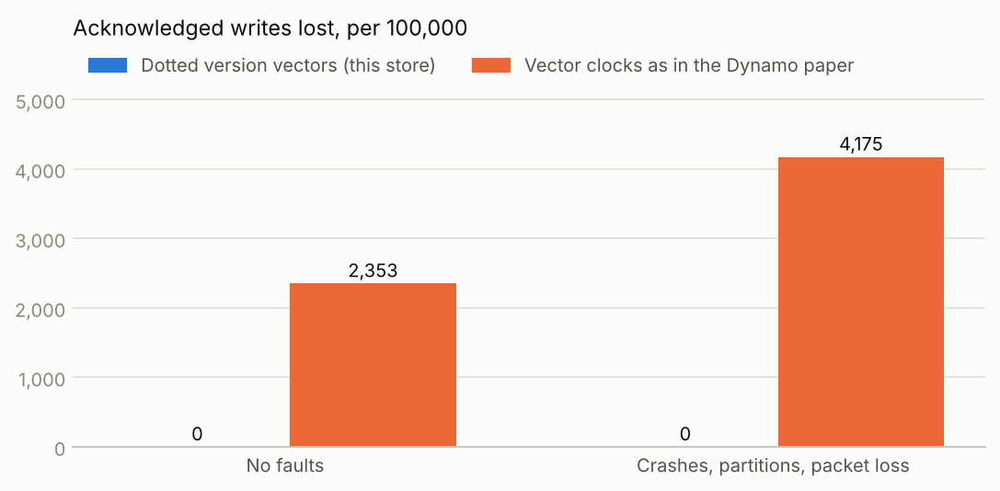

# Testing

## Layers

| Layer | What it covers |
|---|---|
| Unit tests | Ring balance and stability, causality rules, write-ahead log replay, Merkle diffs, wire codec |
| Scenario tests | One mechanism at a time on the simulator: sloppy quorum and hinted handoff, strict quorum, read repair, anti-entropy, failure detection, idempotent puts |
| Property tests | Many seeded scenarios with random faults, checked by the checker below |
| TCP tests | A 5-node cluster over real sockets losing and regaining a node; the CLI starting a multi-process cluster |

## The simulator

[`sim.py`](../src/dynamokv/sim.py) runs the real `Node` class. Messages and timers go
through one event queue in virtual time, and every random choice comes from one seed,
so a seed always replays the same run.

* **Network.** Each message takes 0.5 ms plus an exponential delay averaging 2 ms. 1% of
  messages are delayed by another 20-150 ms.
* **Faults.** Every 0.2-1 s of virtual time, one of these happens at random:
  * crash a node (at most 2 down at once)
  * restart a crashed node
  * split the cluster into two random groups
  * heal the split
  * start a lossy period: 5-30% of messages dropped and up to 10% duplicated
  * end a lossy period
* **Crash and restart.** A crash discards the node's in-memory state: pending requests,
  failure-detector state and gossip state. Its storage survives, like a disk.
* **Clients.** 6 clients run read-modify-write cycles on 20 keys for 6 s. Each gets a key
  and puts a new value with the returned context, or only reads 30% of the time.
* **Settling.** After 6 s, all nodes restart, the network heals and the cluster runs
  10 s more with no client traffic.

## The checker

[`checker.py`](../src/dynamokv/checker.py) does not trust the store's clocks. Every value
written is a unique id, and every client records the ids it read before writing. A write
is truly *superseded* only by a write whose client had read it, directly or through a
chain of reads. After the cluster settles, a scenario passes only if:

* **No lost writes.** Every acknowledged write survives, or a write that truly superseded
  it survives.
* **Convergence.** All N replicas of each key hold identical versions, and no hints are
  left undelivered.
* **Clean siblings.** No surviving value is an ancestor of another survivor.
* **No phantoms.** Every surviving value was written by a client.

It also counts **stale reads**: reads that started after a write was acknowledged but
returned neither that write nor anything derived from it.

## Results

Reproduce with `python -m dynamokv.report --seeds 10000`
([`results/simulation.json`](../results/simulation.json)).

| Experiment | Scenarios | Acknowledged writes | Lost | Stale reads | Requests served |
|---|---|---|---|---|---|
| Dotted version vectors, sloppy quorum, faults | 10,000 | 4,658,048 | **0** | 303,944 of 6,824,175 (4.5%) | 96.9% |
| Dotted version vectors, strict quorum, faults | 1,000 | 360,502 | **0** | **0** of 526,464 | 95.2% |
| Dotted version vectors, no faults | 1,000 | 1,096,763 | **0** | 36 of 1,566,811 | 100.0% |
| Paper's vector clocks, no faults | 1,000 | 1,096,695 | 25,800 | 675,448 of 1,566,666 | 100.0% |
| Paper's vector clocks, faults | 1,000 | 459,263 | 19,175 | 209,591 of 673,042 | 96.8% |

<picture>
  <source media="(prefers-color-scheme: dark)" srcset="../results/figures/lost_writes_dark.png">
  
</picture>

Across the 10,000 fault scenarios, the simulator injected 19,787 crashes and
12,978 network partitions. It dropped 1.2 million of 86 million messages.
The store answered with 372,135 hinted-handoff deliveries, 603,563 read repairs
and 134,684 anti-entropy repairs. The most siblings any key ended with was 10.

**Reading the trade-off.** With a strict quorum, R + W > N guarantees that every read
overlaps every acknowledged write, and the checker confirms zero stale reads even under
partitions. The price is refusing writes when too few preferred replicas are reachable.
The sloppy quorum keeps accepting writes by parking them on fallback nodes; reads that
miss those nodes can be stale until hinted handoff and anti-entropy catch up. The few
stale reads without faults come from the 1% of messages delayed past the 80 ms fallback
timer, which briefly routes a write to a fallback node.
